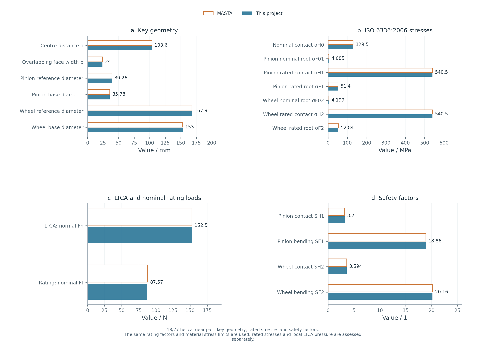
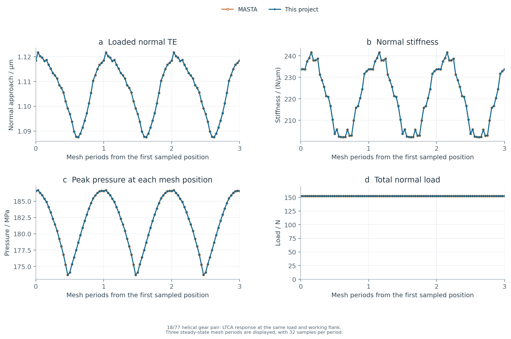
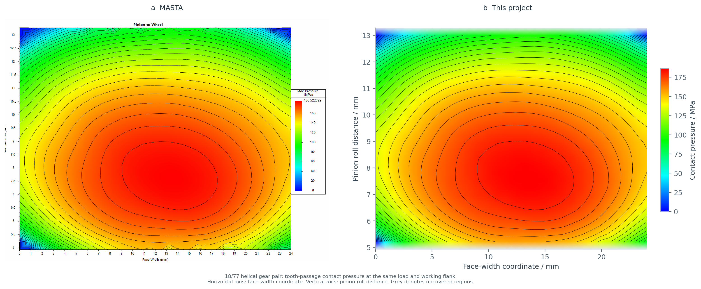
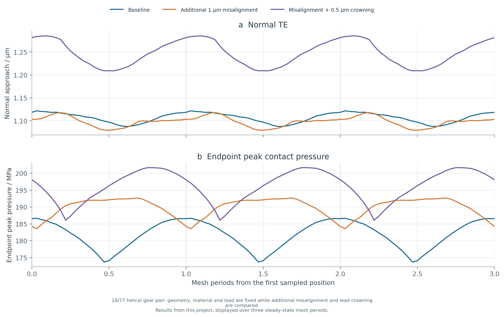

# Cylindrical Gear LTCA

[中文](README.md) · **English**

[](https://www.python.org/) [](LICENSE)

[中文](README.md) | [English](README.en.md)

A Python calculation kernel for involute cylindrical gear geometry, strength rating and quasi-static loaded tooth contact analysis (LTCA). MASTA is used only for numerical benchmarking.

## Contents

- [Installation and use](#installation-and-use)
- [Capabilities](#capabilities)
- [Current case and reproduction](#current-case-and-reproduction)
- [Verification](#verification)
- [Scope](#scope)
- [Updates and roadmap](#updates-and-roadmap)
- [Repository layout](#repository-layout)

## Installation and use

Python 3.10 or 3.11 is recommended. Run from the repository root:

```bash
python -m pip install -c constraints.txt -e ".[plots]"
python -B examples/run_cylindrical_workflow.py --output output/helical_18_77 --plots
```

For calculations without plots, use `python -m pip install -e .`. The command-line entry point is `gear-ltca`; `gear-contact` remains available as an alias.

```python
import json
from pathlib import Path
from gear_contact import analyze_config, export_result

case = json.loads(Path("examples/helical_18_77_case.json").read_text(encoding="utf-8"))
config = case["analysis"]
nominal = case["loading"]["nominal_pinion_torque_n_m"]
config["torque_n_m"] = nominal * case["loading"]["ltca_torque_multiplier"]
config["iso_settings"]["nominal_pinion_torque_n_m"] = nominal
result = analyze_config(config)
export_result(result, "output/helical_18_77_core")
```

Inputs and results use SI units: m, N, Pa, rad and N·m. Positive modification removes material and increases the initial gap. Helix angles have equal magnitudes and opposite signs for external meshes, and the same sign for internal meshes. Put the internal ring gear in `wheel` and keep tooth counts positive.

## Capabilities

|Module|Capabilities|
|---|---|
|Geometry and meshing|Internal/external and spur/helical meshes, profile shifts, reference and base circles, centre distance, active profile limits, contact ratios and discretized contact lines|
|Microgeometry and boundaries|Lead/profile crowning, slopes, tip/root relief, end relief, bias, combined measured deviations, axial offsets and prescribed misalignment|
|Strength rating|ISO 6336:2006 contact/root stresses and safety factors, with rating factors supplied by the user|
|Elasticity|Variable-section tooth beams with local Hertz indentation; optional ISO 6336 total tooth-pair stiffness and Love strip influences|
|Extended contact|Tooth-tip extension geometry, additional gaps and contact-domain checks|
|LTCA|Contact load sharing, transmission error, mesh stiffness, contact pressure and contact half-width|
|Design and data|Multiple operating conditions, parameter sweeps, Pareto screening, JSON/NPZ/CSV data and PNG/SVG plots|

Strength calculations require rating factors and material stress limits. See the [model documentation](docs/model.md) for model choices, parameter definitions and scope.

## Current case and reproduction

An 18/77 external helical gear pair is used to compare geometry, strength, LTCA and contact pressure with MASTA.

|Input|Value|
|---|---:|
|Tooth counts|18 / 77|
|Normal module|2 mm|
|Face width|24 mm|
|Normal pressure angle|22.5°|
|Helix angle magnitude|23.5°, opposite hands|
|Profile shifts|+0.3268 / −0.3268|
|Centre distance|103.5919 mm|
|Material|E=207 GPa, ν=0.3|
|Nominal pinion torque|1.718873 N·m|
|LTCA torque|2.536165 N·m|

```bash
python -B examples/run_cylindrical_workflow.py examples/helical_18_77_case.json --reference examples/helical_18_77_reference.json --output output/helical_18_77 --plots
```

The [case input](examples/helical_18_77_case.json) defines geometry, materials, modifications, boundaries, loads and discretization. Nominal torque is used for strength rating; the LTCA torque includes load factors.

**Key geometry and strength**



The comparison covers reference/base diameters, centre distance, contact/root stresses and safety factors for both gears. The same rating factors and material stress limits are used.

**LTCA cycle response**



This case uses ISO total stiffness, Love strip influences and tooth-tip extension. Both calculations use the same load and working flank, with 32 mesh positions per period and 40 strips per contact line. One steady-state period is displayed over three periods; the statistics below use a single period.

|Cycle metric|MASTA|This project|Relative difference|
|---|---:|---:|---:|
|Mean normal TE / μm|1.106705|1.106705|<0.001%|
|Peak-to-peak TE / μm|0.034134|0.034134|<0.001%|
|Mean normal stiffness / N/μm|220.932698|220.932698|<0.001%|
|Maximum contact pressure / MPa|186.674352|186.674382|<0.001%|

Full values are available in the [comparison table](examples/results/helical_18_77/comparison.csv).

**Contact pressure comparison**



MASTA results are shown on the left and this project's results on the right, for the same load and working flank over one tooth passage. The horizontal axis is the face-width coordinate, the vertical axis is pinion roll distance, and colour indicates pressure. Grey denotes uncovered regions.

Separate views are available for the [MASTA contact pressure](examples/results/helical_18_77/07_masta_native_contact.png), [instantaneous pressure bands at the same phase](examples/results/helical_18_77/en/04_contact_pattern.png), and [contact positions and cycle coverage](examples/results/helical_18_77/en/05_contact_coordinates.png). Tooth-passage pressure distributions and instantaneous loaded regions are shown separately.

Plots and data are in the [case results directory](examples/results/helical_18_77/). The case command generates complete contact data and SVG plots. To reproduce the English figures:

```bash
python -B examples/generate_english_figures.py --output output/helical_18_77_en
```

**Misalignment and crowning sensitivity for the same case**

Geometry, material, load, existing modifications and prescribed boundaries are retained. The alternatives add 1 μm of end-to-end misalignment, then an additional 0.5 μm of pinion lead crowning under that misalignment. This analysis is included in the case command above.



|Metric|Baseline|Additional misalignment|Misalignment + additional crowning|
|---|---:|---:|---:|
|Peak-to-peak TE / μm|0.034134|0.038338|0.076337|
|Mean stiffness / N/μm|220.933|213.019|202.738|
|Endpoint peak pressure / MPa|186.674|192.671|201.673|

All three alternatives are calculated by this project. Additional crowning increases both TE variation and peak pressure in this operating condition; modification selection depends on load, misalignment and existing microgeometry.

## Verification

```bash
python -B examples/run_examples.py --output output/full
python -B examples/validate_cases.py --output output/case_validation
python -B examples/check_phase_resolution.py --output output/phase_resolution
python -B examples/run_benchmarks.py --output output/masta --plots --require-common-match
python -B -m unittest discover -s tests -v
```

Verification covers internal/external and spur/helical meshes, combined modifications, dissimilar materials, load changes, mirrored misalignment, zero load and similarity laws. See the [verification data](examples/results/validation/).

## Scope

Contact analysis assumes small deformation, linear elasticity, no friction and quasi-static loading. The current models do not include complete gear-body, shaft or bearing deformation, lubrication, temperature rise, fatigue life or dynamic noise.

Strength ratings and local LTCA contact pressure are assessed separately. Validation currently relies on numerical comparisons; experimental accuracy has not been established.

Equations and assumptions are described in the [model documentation](docs/model.md). Functions, units and array layouts are described in the [interface documentation](docs/api.md). These detailed documents are currently in Chinese.

## Updates and roadmap

- **0.1.0**: Involute cylindrical gear geometry, modifications, tooth-beam elasticity, Hertz contact, LTCA and comparison of operating conditions.
- **0.2.0**: ISO total stiffness and Love strip influences, tooth-tip extension, ISO 6336:2006 explicit-factor strength rating, and the 18/77 MASTA benchmark with three-period curves, contact pressure and misalignment/crowning sensitivity; Chinese and English documentation and figures.
- **Near-term plans**: More internal-mesh and edge-contact cases, mesh and phase convergence studies, and independent 3D contact and experimental validation.
- **Further extensions**: Coupled finite-tooth, gear-body and support compliance, more complete standard rating-factor and material-life calculations, and parametric microgeometry optimization. These items are planned capabilities.

## Repository layout

`gear_contact/` contains the calculation and post-processing modules; `examples/` contains inputs and runnable workflows, with selected results in `examples/results/`; `docs/` contains model and interface documentation; `tests/` and `.github/` run verification. Released under the [MIT licence](LICENSE).
