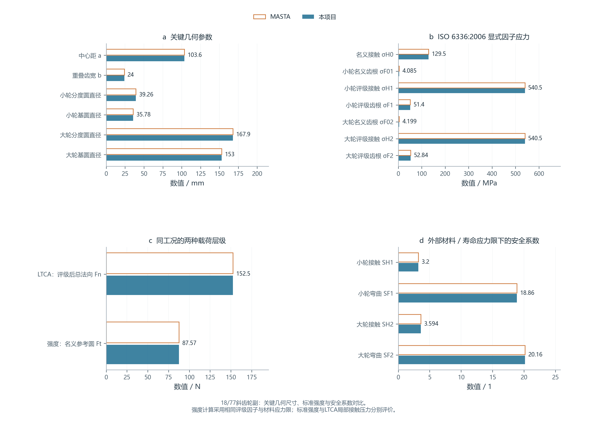
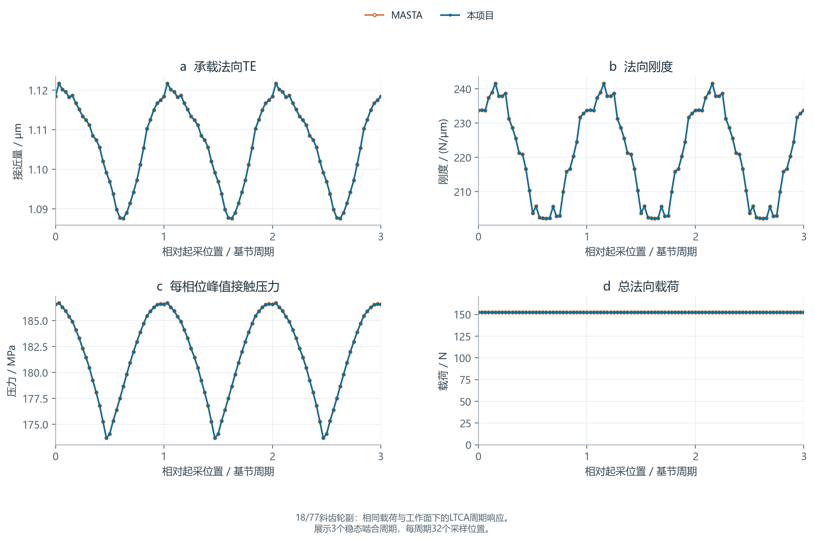
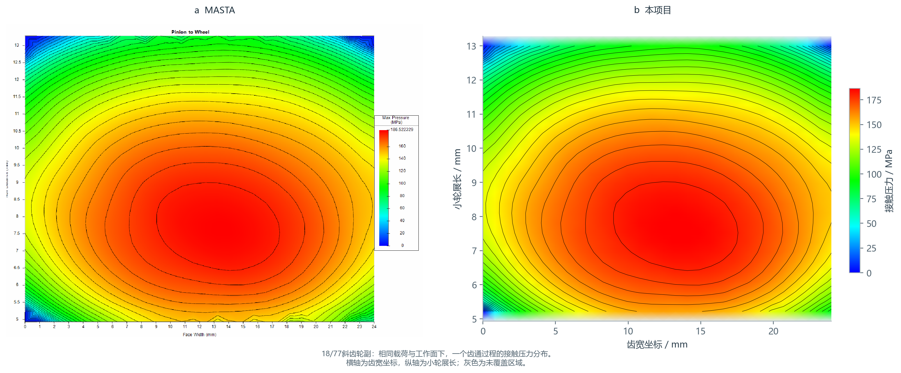
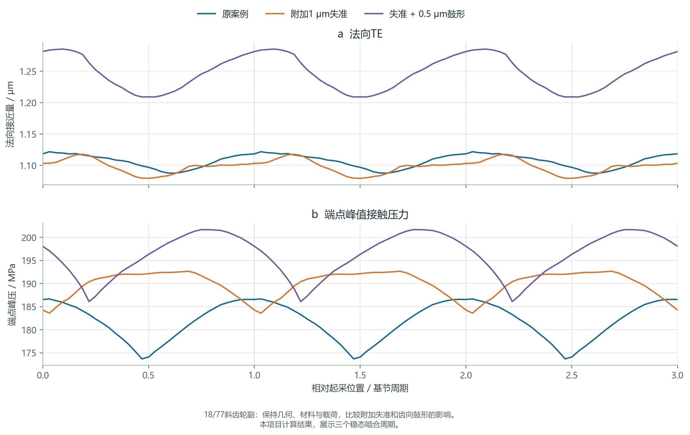

# Cylindrical Gear LTCA

[中文](README.md) · [English](README.en.md)

[](https://www.python.org/) [](LICENSE)


渐开线圆柱齿轮几何、标准强度与准静态承载齿面接触分析的独立 Python 计算内核。MASTA仅用于本项目的数值对标。

## 目录

- [安装与调用](#安装与调用)
- [计算能力](#计算能力)
- [当前案例与复算](#当前案例与复算)
- [验证与复算](#验证与复算)
- [适用范围](#适用范围)
- [更新记录与后续计划](#更新记录与后续计划)
- [文件组织](#文件组织)

## 安装与调用

建议 Python 3.10 或 3.11。在项目根目录执行：

```bash
python -m pip install -c constraints.txt -e ".[plots]"
python -B examples/run_cylindrical_workflow.py --output output/helical_18_77 --plots
```

仅使用计算内核时可执行 `python -m pip install -e .`。命令入口为 `gear-ltca`，`gear-contact` 为兼容别名。

```python
import json
from pathlib import Path
from gear_contact import analyze_config, export_result

case = json.loads(Path("examples/helical_18_77_case.json").read_text(encoding="utf-8"))
config = case["analysis"]
nominal = case["loading"]["nominal_pinion_torque_n_m"]
config["torque_n_m"] = nominal * case["loading"]["ltca_torque_multiplier"]
config["iso_settings"]["nominal_pinion_torque_n_m"] = nominal
result = analyze_config(config)
export_result(result, "output/helical_18_77_core")
```

输入与计算结果采用SI单位：长度 m、力 N、压力 Pa、角度 rad、扭矩 N·m。正修形表示材料去除、增大初始间隙。外啮合两轮螺旋角等值异号，内啮合同号；内齿圈设置在 `wheel`，齿数保持正整数。

## 计算能力

|模块|功能|
|---|---|
|几何与啮合|内／外啮合、直／斜齿、变位、分度圆与基圆、中心距、有效形径、重合度和接触线离散|
|修形与边界|齿向／齿廓鼓形、坡度、顶根修缘、端修、Bias、测量偏差组合、轴向错位和给定失准|
|标准强度|ISO 6336:2006接触／齿根应力及安全系数，评级因子由用户提供|
|弹性模型|变截面齿梁与局部Hertz压陷；可选ISO 6336综合齿对刚度及Love条带影响|
|延伸接触|齿顶延伸几何、附加间隙及接触区域判定|
|LTCA|接触载荷分配、TE、啮合刚度、接触压力及接触半宽|
|设计与数据|多工况方案比较、参数扫描、Pareto筛选，JSON／NPZ／CSV和PNG／SVG图表|

标准强度计算需要给定评级因子和材料应力限。模型选择、参数定义和计算范围见[模型说明](docs/model.md)。

## 当前案例与复算

采用18/77外啮合斜齿轮副，比较本项目与MASTA的几何、标准强度、LTCA和接触压力结果。

|输入|数值|
|---|---:|
|齿数|18 / 77|
|法向模数|2 mm|
|齿宽|24 mm|
|法向压力角|22.5°|
|螺旋角幅值|23.5°，两轮旋向相反|
|变位系数|+0.3268 / −0.3268|
|中心距|103.5919 mm|
|材料|E=207 GPa，ν=0.3|
|名义小轮扭矩|1.718873 N·m|
|LTCA目标扭矩|2.536165 N·m|

```bash
python -B examples/run_cylindrical_workflow.py examples/helical_18_77_case.json --reference examples/helical_18_77_reference.json --output output/helical_18_77 --plots
```

[案例输入](examples/helical_18_77_case.json)包含几何、材料、修形、边界、载荷和离散参数。名义扭矩用于标准强度计算，LTCA扭矩包含载荷系数。

**关键几何参数与标准强度**



对比分度圆、基圆、中心距等关键尺寸，以及两轮的接触应力、齿根应力和安全系数。强度计算采用相同的评级因子与材料应力限。

**LTCA周期响应**



本案例采用ISO综合刚度与Love条带模型，考虑齿顶延伸。双方按相同载荷和工作面计算，每周期取32个啮合位置，每条接触线划分40个条带。曲线将一个稳态周期展开为三个周期，表中指标取自单周期结果。

|周期指标|MASTA|本项目|相对差|
|---|---:|---:|---:|
|平均法向TE / μm|1.106705|1.106705|<0.001%|
|TE峰峰值 / μm|0.034134|0.034134|<0.001%|
|平均法向刚度 / N/μm|220.932698|220.932698|<0.001%|
|最大接触压力 / MPa|186.674352|186.674382|<0.001%|

完整数值见[结果对比表](examples/results/helical_18_77/comparison.csv)。

**接触斑点对比**



左侧为MASTA结果，右侧为本项目结果，对比相同载荷和工作面下一个齿通过程的接触压力分布。横轴为齿宽坐标，纵轴为小轮展长，颜色表示接触压力；灰色为未覆盖区域。

可单独查看[MASTA接触压力图](examples/results/helical_18_77/07_masta_native_contact.png)、[同相位瞬时压力带对比](examples/results/helical_18_77/04_contact_pattern.png)及[接触位置与周期覆盖](examples/results/helical_18_77/05_contact_coordinates.png)。整齿通过程的压力分布与单相位承载区域分别展示。

图表与数据位于[案例结果目录](examples/results/helical_18_77/)。运行案例命令可生成完整接触数据及SVG图表。

**同一案例的失准与鼓形敏感性**

保持18/77案例的几何、材料、载荷、已有修形及给定边界，依次附加1 μm齿宽两端失准，以及在相同失准下追加0.5 μm小轮齿向鼓形。上述案例命令同时生成本项分析。



|指标|原案例|附加失准|失准＋附加鼓形|
|---|---:|---:|---:|
|TE峰峰值 / μm|0.034134|0.038338|0.076337|
|平均刚度 / N/μm|220.933|213.019|202.738|
|端点峰压 / MPa|186.674|192.671|201.673|

表中三方案均为本项目计算结果。附加鼓形在该工况下增大了TE波动和峰压，修形方案需要结合载荷、失准和已有修形选取。

## 验证与复算

```bash
python -B examples/run_examples.py --output output/full
python -B examples/validate_cases.py --output output/case_validation
python -B examples/check_phase_resolution.py --output output/phase_resolution
python -B examples/run_benchmarks.py --output output/masta --plots --require-common-match
python -B -m unittest discover -s tests -v
```

验证覆盖内外啮合、直斜齿、组合修形、异材料、载荷变化、失准镜像、零载及相似律，结果见[验证数据](examples/results/validation/)。

## 适用范围

接触分析采用小变形、线弹性、无摩擦、准静态假设。当前模型不包含完整轮体、轴系和轴承变形，也未计算润滑、温升、疲劳寿命或动态噪声。

标准强度与LTCA局部接触压力分别评价。当前验证以数值对标为主，尚未进行物理试验精度验证。

公式和边界见[模型说明](docs/model.md)，函数、单位及数组布局见[接口说明](docs/api.md)。

## 更新记录与后续计划

- **0.1.0**：建立渐开线圆柱齿轮几何、修形、齿梁弹性、Hertz接触、LTCA及多工况方案比较。
- **0.2.0**：增加ISO综合刚度与Love条带模型、齿顶延伸、ISO 6336:2006显式因子强度，以及18/77案例的MASTA对标、三周期曲线、接触压力图和失准／鼓形敏感性；提供中英文说明及图表。
- **近期计划**：扩展内啮合与边缘接触案例，完善网格和相位收敛研究，增加独立三维接触与试验验证。
- **后续扩展**：有限齿体、轮体及支承柔度耦合，更完整的标准评级因子与材料寿命链，以及参数化修形优化。以上均为计划。

## 文件组织

`gear_contact/` 为计算与后处理模块；`examples/` 为输入及运行脚本，`examples/results/` 为精选结果；`docs/` 为模型与接口说明；`tests/` 和 `.github/` 执行验证。采用 [MIT许可](LICENSE)。


源码来源审查（初步）：[查看三个项目的来源线索与审查边界](https://github.com/Lilililiyyy/gear-transmission-skills/blob/docs/unified-readme-2026/docs/source-provenance-review.md)。