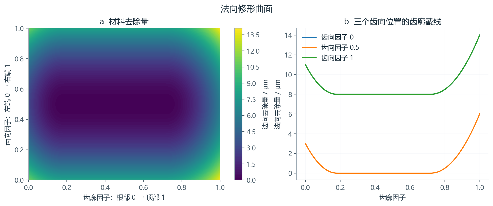
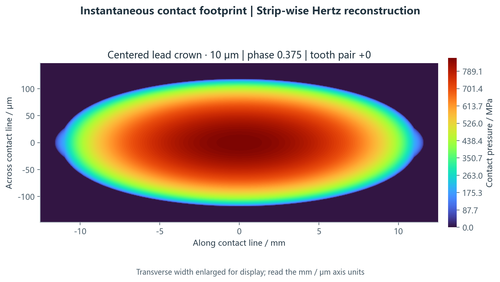
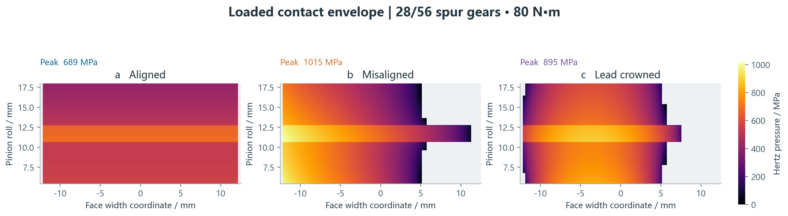
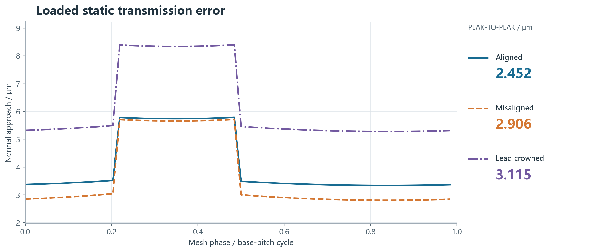
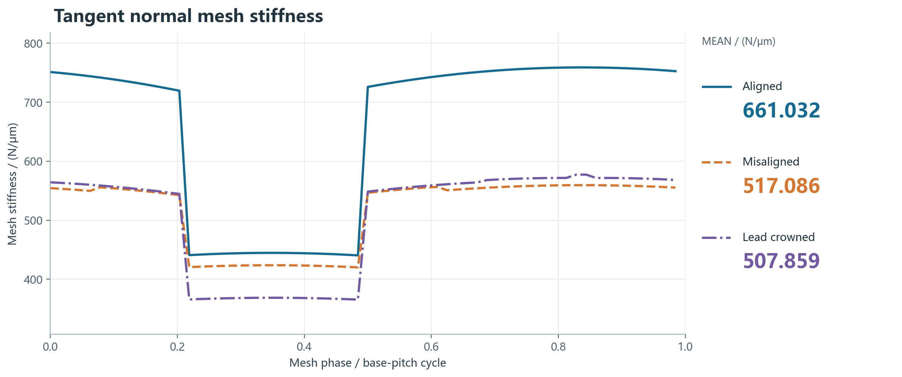
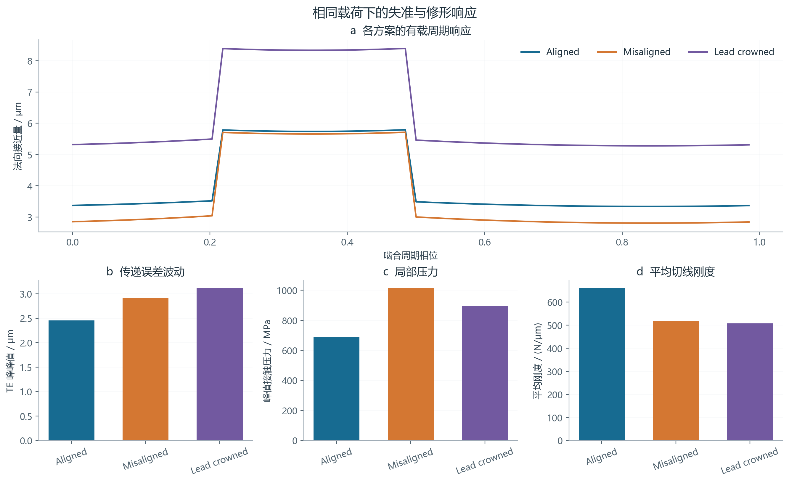

# 可运行案例

在仓库根目录执行：

```bash
python -B examples/run_examples.py --output output/full
```

`--quick`缩小网格，适合检查接口和安装；正式默认32相位、每接触线21条带。所有数值均为确定性合成案例，不是仪器实测数据。

|案例|主要问题|
|---|---|
|解析弹簧和Hertz|力平衡、开闭、接近量、压力积分|
|28/56直齿基准|单／双齿承载切换及周期TE|
|10μm齿向鼓形|接触宽度与局部压力变化|
|组合修形|齿向、齿顶、齿根修形的叠加|
|12μm安装失准|偏载形成及鼓形方案的作用|
|20/40/80/120N·m|同一方案的载荷适应性|
|20°斜齿及28/84内啮合|接触线和曲率符号|
|合成测量残差|参数修形与带正负偏差的测量接口组合|
|11/21/41条带|空间离散敏感性|
|三方案×三工况|最坏值与Pareto候选|

案例输入、完整数组、数据表与图形统一写入指定输出目录。精选结果摘要见[data/case_metrics.csv](data/case_metrics.csv)，空间检查见[data/grid_convergence.json](data/grid_convergence.json)。













## 相位采样

```bash
python -B examples/check_phase_resolution.py --output output/phase_resolution
```

这项检查固定21条带，比较16/32/64相位，分别保存每一级原数组。末两级TE峰峰值、最大压力和平均刚度变化超过默认2%阈值时，以非零退出码提示继续细化；详见[data/phase_resolution.json](data/phase_resolution.json)。

## 解释结果

减小TE、减小压力、提高承载覆盖率可能产生取舍。某个合成方案不保证优于无修形基准；应使用`design_study.json`逐工况比较，而不能只看单一图面。谱是静态TE的阶次分解，不构成动态振动或声压预测。

各定量图都有对应 CSV。`contact_pattern` 为单相位、单齿对的瞬时压力条带重建，`contact_envelope` 为整个周期的承载包络。解释与复现命令见[绘图说明](plotting.md)。完整输出被 Git 忽略，需要共享具体结果时可另行选择数据文件。
